# Documentación del Ejercicio Práctico de Git y GitHub 
## Crear la identidad, la carpeta y acceder a ella:
```bash
git config --global user.name "Daniel"
git config --global user.email "danielsabidop12@gmail.com"
mkdir ejercicio\git 
cd ejercicio\git
```
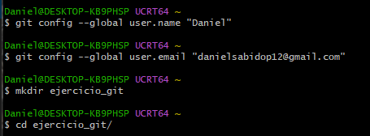
## Crear el archivo .txt y el script.sh:
```bash
nano texto.txt
nano script.sh
```
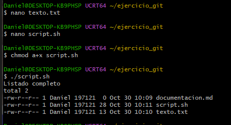
## Inicializar el repositorio Git, ver el estado y cambiar el nombre a la rama (y luego restaurarlo):
```bash
git init
git status
git branch -m main
git branch -m master
```
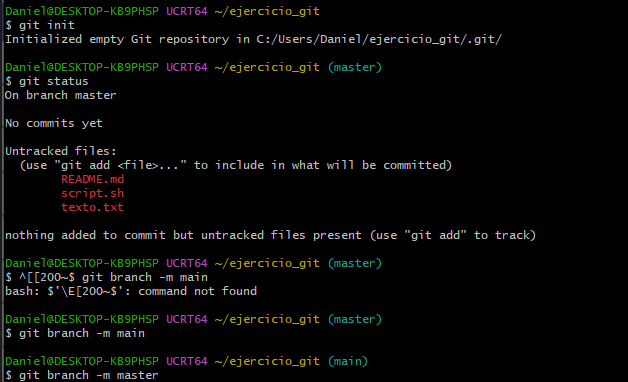
## Añadir archivos y confirmamos
```bash
git add texto.txt
git add script.sh
git add README.md

git commit -m "Confirmación inicial"
```
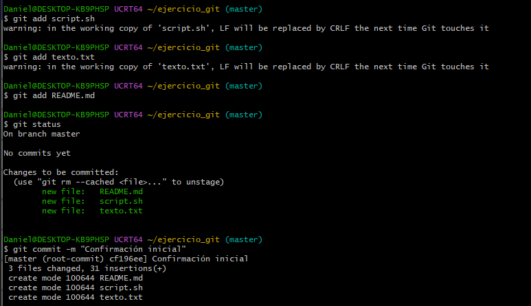
## Modificar texto.txt

```bash
nano texto.txt #Y agregar nueva línea "cuatro" y "cinco"
git add texto.txt
git commit -m "Ampliada la explicación del texto"
```
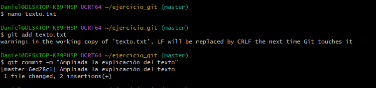
## Ver el último cambio y los cambios históricos:
```bash
git show
git log
```
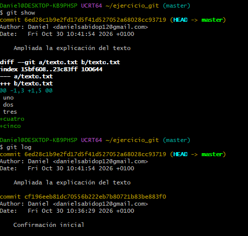
## Modificar texto.txt y ver diferencias de archivos:

```bash
nano texto.txt #Borrar linea "tres" y agregar linea "seis"
get diff
git commit -a -m "Probando diff"
nano texto.txt #Agregar linea "siete"
git diff
```
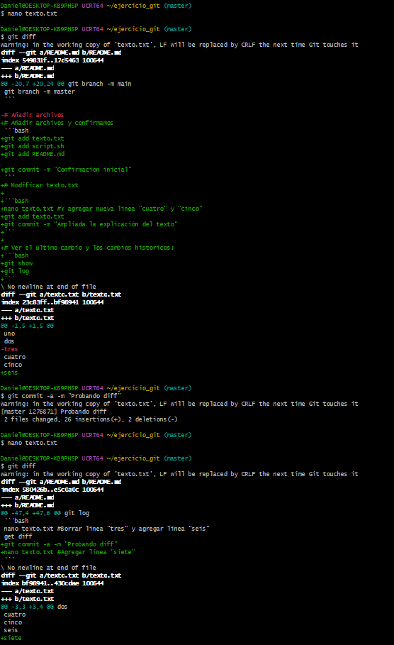
## Ignorar archivos:

```bash
nano .gitignore #Crear archivo para gestionar archivos a ignorar
```
Dentro del archivo agregar:
```text
# ignora los archivos terminados en .class
*.class 
# ignora los archivos terminados en ~
*~ 
# pero no importante~, aun cuando habia ignorado los archivos terminados en ~ en la linea anterior 
!importante~
```
Crear otros 2 archivos, uno llamado Hola.java con el siguiente contenido:
```java
class Hola {
 public static void main(String[] args){
 System.out.println("Welcome to the Java World");
 }
}
```
Y otro llamado temporal~ y importante~
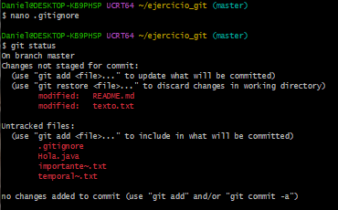
Guardar en el repositorio:
```bash
git add .
git commit -m "Añadidos fuentes en java y archivos importantes"
```
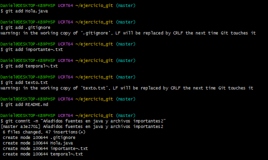

## Tags y gestión de versiones
```bash
git tag v0.7 #Agregar tag
```
Para agregar un tag a una version anterior:
```bash
git log #Para ver el código hash de la verson que queramos.
git tag v0.3 6ed28c1b9e2fd17d5f41d527052a68028cc93719

git log --onleline
```
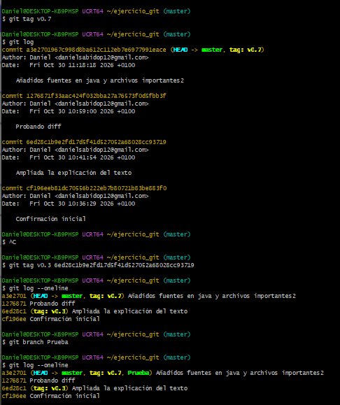
## Ramas
Crear una rama llamada Prueba:
```bash
git branch Prueba
```
Para ver las ramas creadas
```bash
git branch
```
Para cambiar de rama
```bash
git switch Prueba
```
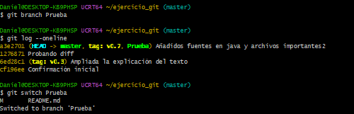
Modifico el archivo Hola.java y le agrego esta línea:
```java
System.out.println("I have no more branches to commit, said the Ent");
```
Y hacemos el commit y le agregamos un tag:
```bash
git commit -a -m “Llegan los Ents a Java”
git tag v0.7-Ent-Release
```
Y volver a la rama principal
```bash
git switch master
cat Hola.java #Comprobar contenido
```
Para juntar Prueba con la rama principal:
```bash
git merge Prueba
```
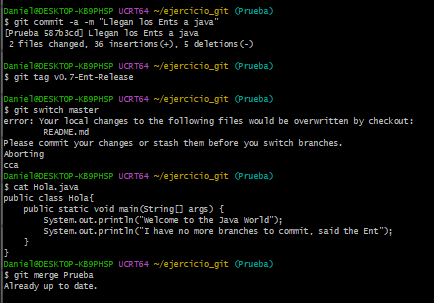

## Eliminar y quitar de seguimiento.

Eliminar un archivo:
```bash
git rm importante~.txt
git commit -m "Elminado archivo importante~"
```
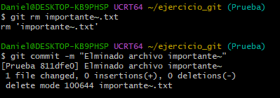
Para quitar un archivo ya en seguimiento (como los .class):
```bash
git reset HEAD *.class
```
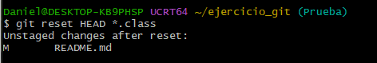

## Clonar proyecto
```bash
git clone https://github.com/ColegioVivasCurro/HolaED
```